<div align="center">

# PokerLab

### Probability. Strategy. Uncertainty.

**A local-first research instrument for Hold’em probability, reproducible simulation, decision theory, and finite game solving.**<br>
**一个本地优先的德州扑克概率、可复现模拟、决策理论与有限博弈研究工具。**

[](https://github.com/kyky2347/pokerlab/actions/workflows/ci.yml)
[](LICENSE)
[](apps/api/pyproject.toml)
[](apps/web/package.json)
[](rust-toolchain.toml)

[Quick start / 快速开始](#quick-start--快速开始) · [Architecture / 架构](#architecture--架构) · [Validation / 验证](#validation--验证) · [Download ZIP](https://github.com/kyky2347/pokerlab/archive/refs/heads/main.zip)

</div>

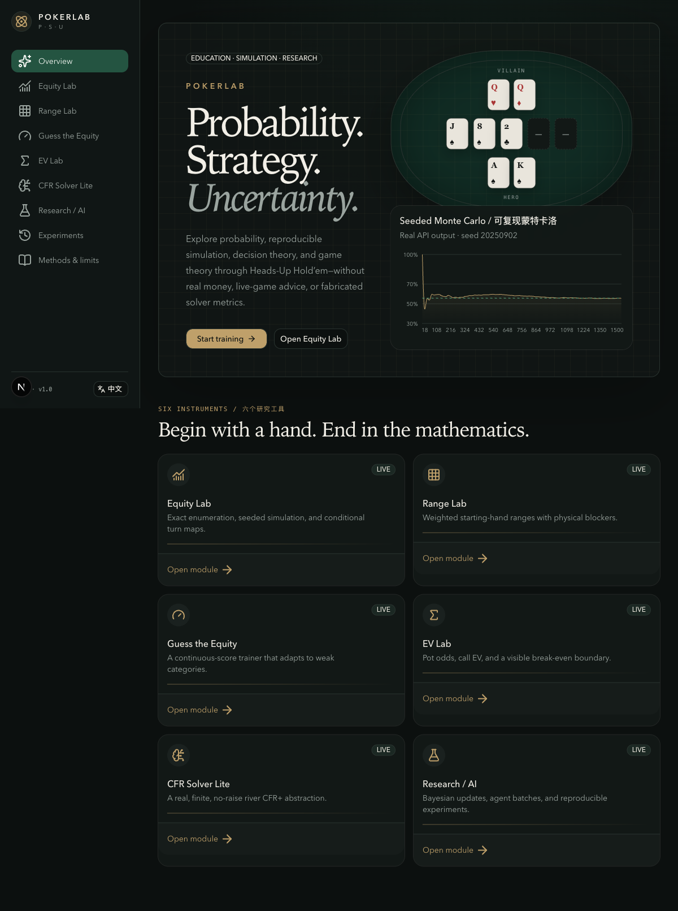

## What makes PokerLab different / 为什么是 PokerLab

PokerLab is designed as an inspectable research system—not a casino skin and not a collection of disconnected calculators. The browser never invents canonical poker results: every displayed equity, confidence interval, strategy, and experiment record comes from the typed API and the tested poker core.

PokerLab 是一套可审查的研究系统，而不是赌场风格外壳或互不关联的小工具集合。浏览器不会自行生成“官方结果”；界面中的胜率、置信区间、策略和实验记录均来自类型化 API 与经过测试的扑克核心。

- **One source of mathematical truth / 单一数学真值源** — Python reference evaluator plus a cross-checked Rust/PyO3 accelerator.
- **Reproducible by construction / 从设计上可复现** — stochastic runs store their seed, parameters, engine, runtime, and result.
- **Durable training / 可持续训练** — issued questions survive API restarts for 24 hours. One transaction claims the question, saves the score and prepares feedback; pre-commit feedback failures allow retry without duplicate scores. [Retry boundaries / 重试边界](docs/deployment.md#training-feedback-and-retry-boundaries--训练反馈与重试边界). / 已出题目在 24 小时有效期内可跨 API 重启提交；领取题目、保存评分与准备反馈在同一事务完成，提交前反馈失败可重试，不重复计分。
- **Recoverable practice / 可恢复的练习流程** — manual retries retain the requested seed or estimate; the next question does not erase confirmed feedback until it loads. Accessible, bilingual controls lock during submission, expose the actual engine, and distinguish confirmed page totals from the last database-wide weakness snapshot. / 手动重试保留请求种子或估计值，新题加载成功前保留已确认反馈；双语无障碍控件在提交中锁定，展示实际引擎，并区分本次页面的已确认统计与最近一次数据库薄弱项快照。
- **Real finite solving / 真实有限求解** — CFR+ is implemented in this repository and verified against Kuhn Poker; no third-party solver is used.
- **Honest limits / 坦诚展示边界** — the river solver’s no-raise abstraction is visible in the UI and documentation.
- **Auditable policy comparisons / 可核验策略比较** — named fixed policies, editable seeds, approximate mean-EV intervals, and versioned JSON/CSV exports. This synthetic benchmark does not train CFR agents or measure real poker winnings. / 明确的固定策略、可编辑种子、平均 EV 近似区间与带方法版本的 JSON/CSV 导出；此合成基准不训练 CFR 代理，也不衡量实际扑克盈利。详见 [research methods / 研究方法](docs/research-methods.md)。
- **Local-first / 本地优先** — SQLite works out of the box; PostgreSQL and Docker Compose are supported without making cloud accounts mandatory.
- **English and Chinese / 中英双语** — the product shell, primary workflows, safety copy, and documentation are available in both languages.

## Product tour / 功能导览

| Instrument / 工具                    | What it does / 功能                                                                                                                                                                                                                               |
| ------------------------------------ | ------------------------------------------------------------------------------------------------------------------------------------------------------------------------------------------------------------------------------------------------- |
| **Equity Lab / 胜率实验室**          | Exact legal-runout enumeration, seeded Monte Carlo, estimated standard error, conservative pointwise 95% Hoeffding intervals, and a conditional turn map. / 精确枚举、固定种子蒙特卡洛、估计标准误、保守的逐点 95% Hoeffding 区间与条件转牌地图。 |
| **Range Lab / 范围实验室**           | A weighted 13×13 range matrix, physical blockers, combo accounting, and range-vs-range equity. / 13×13 加权范围矩阵、物理阻断牌、组合统计与范围对范围胜率。                                                                                       |
| **Guess the Equity / 猜胜率**        | Legal scenarios, continuous quadratic scoring, and an interpretable weakness-weighted sampler. / 合法牌局、连续二次评分与可解释的薄弱项加权出题。                                                                                                 |
| **EV Lab / EV 实验室**               | Explicit pot conventions, break-even equity, incremental call EV, and decision curves. / 明确的底池约定、盈亏平衡胜率、增量跟注 EV 与决策曲线。                                                                                                   |
| **CFR Solver Lite / CFR 轻量求解器** | A real blocker-aware CFR+ river abstraction with mixed strategies and convergence diagnostics. / 真实运行、阻断牌感知的河牌 CFR+ 抽象、混合策略与收敛诊断。                                                                                       |
| **Research / AI / 研究实验室**       | Beta–Binomial inference, seeded convergence exports, and transparent agent comparisons. / Beta–Binomial 推断、固定种子收敛导出与透明代理对比。                                                                                                    |
| **Experiment ledger / 实验台账**     | Lightweight cursor pagination, actual database attribution, and lossless complete JSON export. Research comparisons also offer CSV. / 轻量游标分页、真实数据库标识及无损完整 JSON 导出；研究对比另提供 CSV。                                      |

<details>
<summary><strong>Open the visual gallery / 展开界面画廊</strong></summary>

### Equity and ranges / 胜率与范围

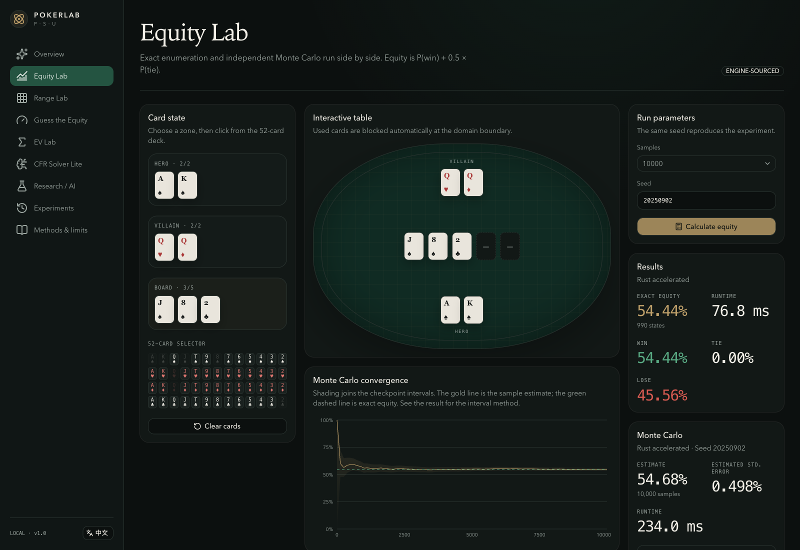

Real API output: 10,000 samples, seed `20250902`, Rust evaluator. The shaded region connects conservative pointwise intervals, not a simultaneous confidence band. See the [bilingual uncertainty guide](docs/math/monte-carlo.md) and mobile result. / 真实 API 输出：10,000 个样本、种子 `20250902`、Rust 评估器。阴影连接保守的逐点区间，不是同时置信带；详见[双语不确定性指南](docs/math/monte-carlo.md)及移动端结果。

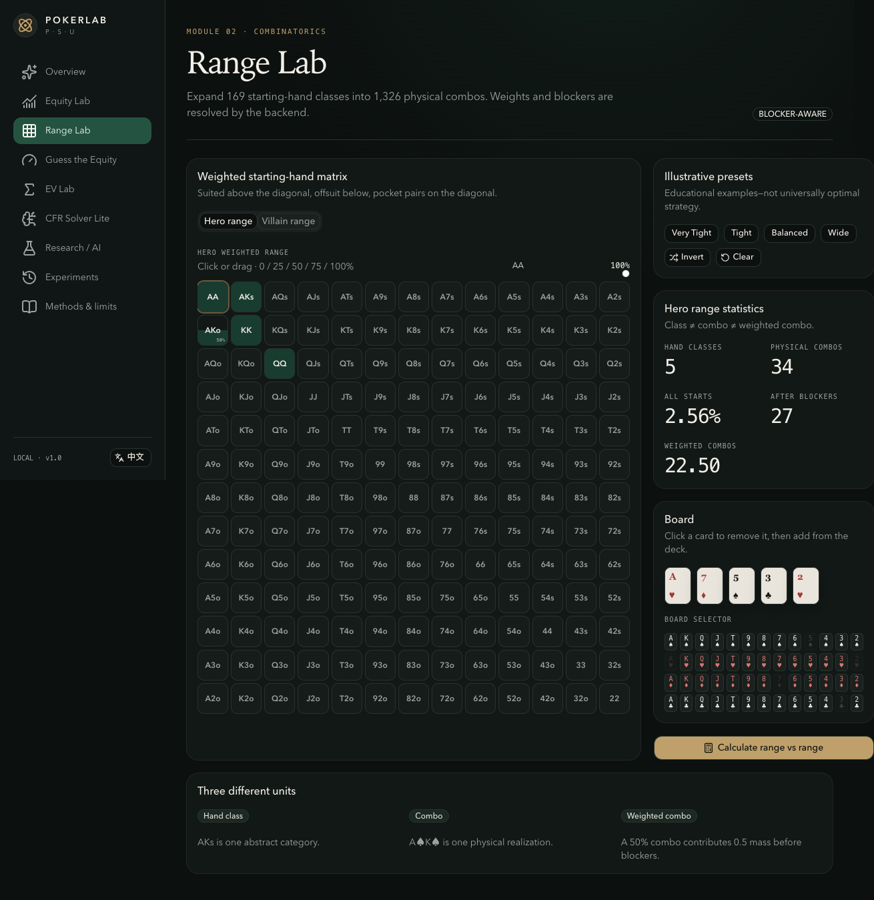

### Training and decision theory / 训练与决策理论

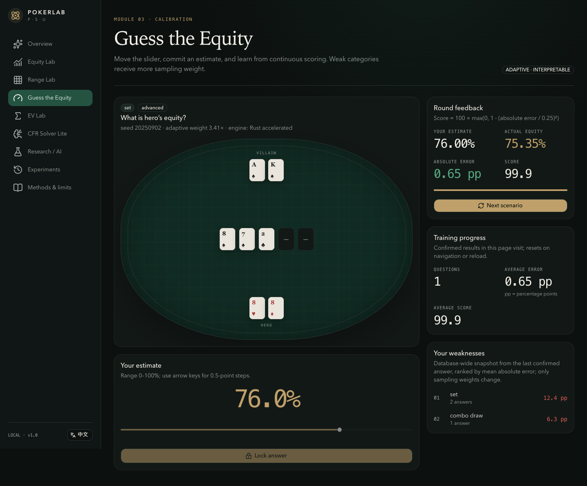

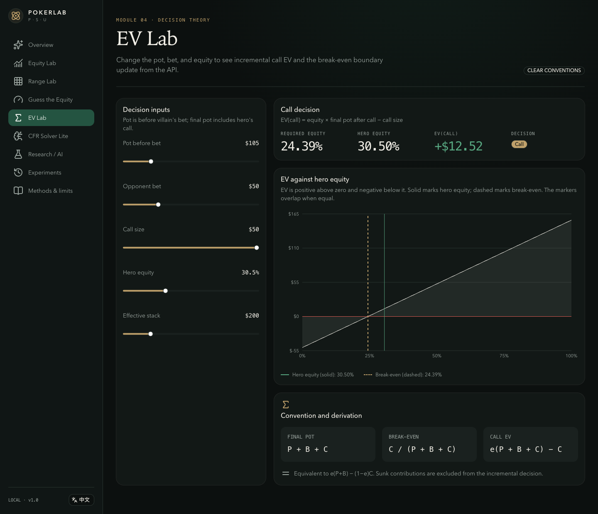

EV markers use continuous coordinates, including fractional break-even thresholds and 0.5-point slider steps. Solid and dashed markers have bilingual value labels; the zero line distinguishes positive and negative EV. [Chart conventions and worked example](docs/math/expected-value.md#reading-the-chart--阅读图表). / EV 标记使用连续坐标，支持小数盈亏平衡阈值与 0.5 个百分点的滑块步长；实线、虚线配有双语数值图例，零线区分 EV 正负。详见[图表约定与算例](docs/math/expected-value.md#reading-the-chart--阅读图表)。

[Chinese mobile EV chart / 中文移动端 EV 图表](output/playwright/ev-zh-mobile.png)

### Game theory and research / 博弈论与研究

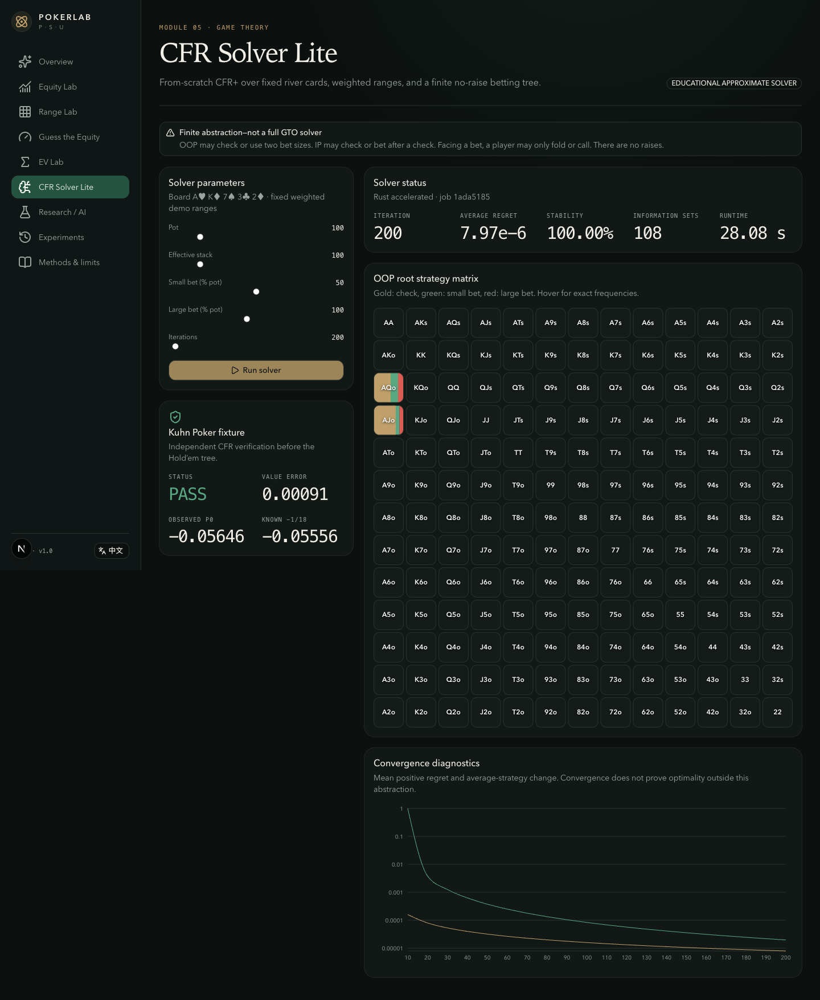

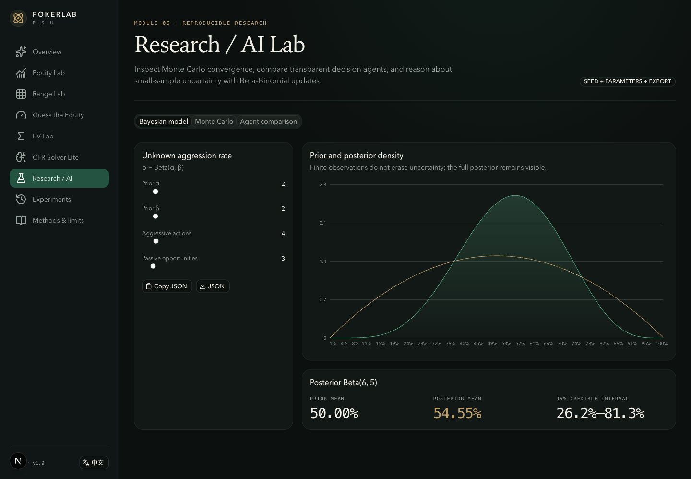

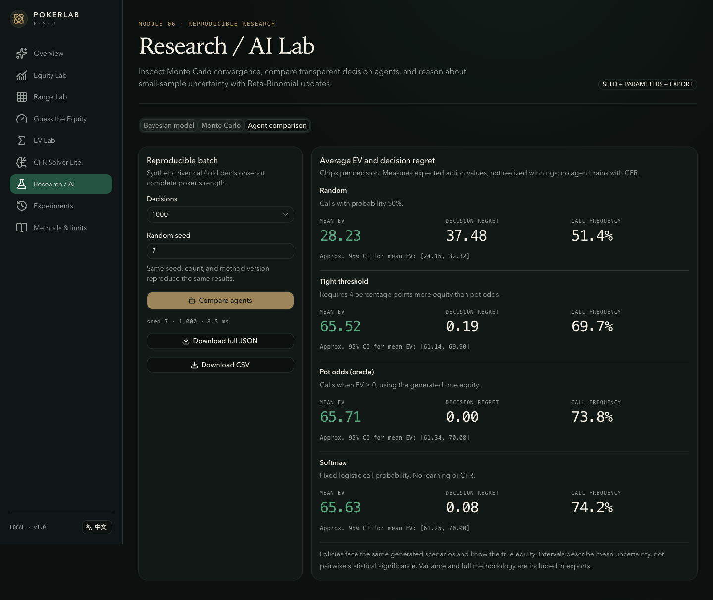

Research comparison: real API output, seed `7`, 1,000 synthetic decisions. See [methods and interpretation](docs/research-methods.md). / 策略比较截图来自真实 API 输出：种子 `7`、1,000 次合成决策；详见[研究方法与解读](docs/research-methods.md)。

### Mobile Chinese interface / 移动端中文界面

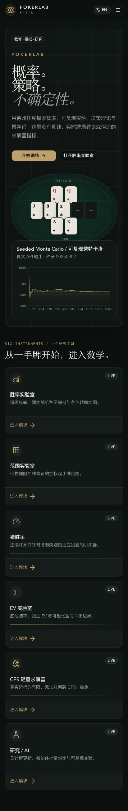

### Paginated experiment history / 分页实验历史

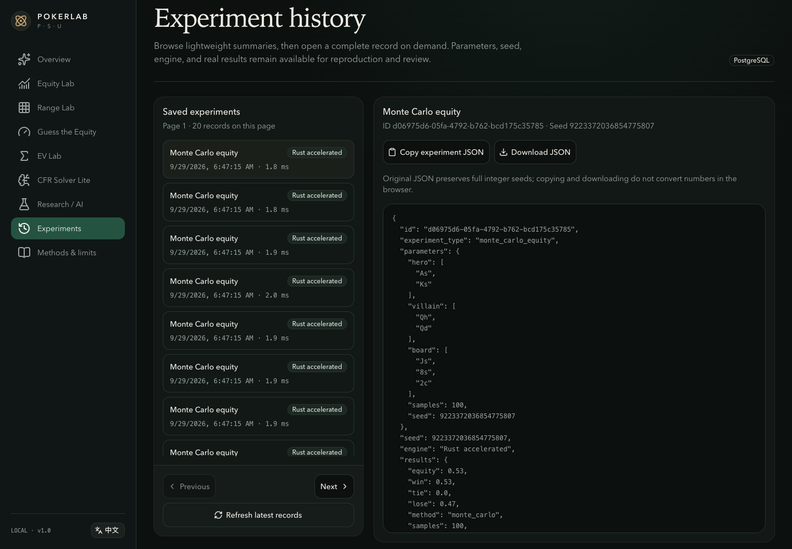

The screenshots use real seeded API runs in an isolated PostgreSQL deployment. See the [bilingual history and export guide](docs/experiment-history.md), including the mobile view. / 截图来自隔离 PostgreSQL 部署中的真实固定种子 API 实验；详见[中英文历史与导出指南](docs/experiment-history.md)，包含移动端视图。

</details>

## Quick start / 快速开始

### One command: launch the complete system / 一条命令启动完整系统

Install and start Docker Desktop, then run the repository launcher from the project directory:

安装并启动 Docker Desktop，然后在项目目录执行仓库启动器：

```bash
./pokerlab
```

That single command generates a private local database credential, builds and starts PostgreSQL, the Rust-accelerated API, and the production web app, waits for every health check, then opens PokerLab in the default browser.

这一条命令会生成仅保存在本机的随机数据库凭据，构建并启动 PostgreSQL、Rust 加速 API 与生产 Web 应用，等待全部健康检查通过，然后在默认浏览器中打开 PokerLab。

```bash
./pokerlab status          # service health / 服务状态
./pokerlab logs            # live logs / 实时日志
./pokerlab stop            # stop and preserve data / 停止并保留数据
./pokerlab start --no-open # headless start / 启动但不打开浏览器
./pokerlab start --no-build --no-open # reuse images / 复用已有镜像
```

`--no-build` is for unchanged code with images already built. After pulling updates, run `./pokerlab` normally to rebuild. Keep a private backup of `.pokerlab.env`: if it is lost while the database volume remains, restore the original credentials; the launcher will not replace them or erase data.

`--no-build` 用于代码未变且镜像已构建的情况；拉取更新后请正常运行 `./pokerlab` 以重新构建。请私密备份 `.pokerlab.env`：若配置丢失但数据库卷仍在，请恢复原凭据；启动器不会擅自更换密码或删除数据。

Ports already in use? Start on a different pair, without editing Compose or stopping another application:

默认端口被占用？无需修改 Compose 或停止其他应用，即可换一组端口启动：

```bash
export POKERLAB_WEB_PORT=13000 POKERLAB_API_PORT=18000
./pokerlab
```

The browser, API build URL, CORS defaults, and health checks follow these ports. Keep the exports for later commands (including `open` and `restart`); they are shell settings, not saved to `.pokerlab.env`. Changing the API port requires a normal rebuild, not `--no-build`. Existing credentials and records stay intact. See [configuration precedence](docs/deployment.md#custom-local-ports--自定义本机端口) for reverse-proxy overrides.

浏览器、前端构建中的 API 地址、默认跨域来源与健康检查会同步使用新端口。后续命令（包括 `open` 和 `restart`）需保留这些环境变量；端口只在终端中设置，不写入 `.pokerlab.env`。修改 API 端口后需正常构建，不能使用 `--no-build`。已有凭据和记录保持不变。反向代理覆盖规则见[配置优先级](docs/deployment.md#custom-local-ports--自定义本机端口)。

Container web/API ports now bind only to `127.0.0.1` by default. PokerLab has no built-in user authentication: CORS is not access control, and public hosting needs an authenticated HTTPS gateway. See [security guidance](SECURITY.md).

容器 Web/API 端口现在默认仅绑定 `127.0.0.1`。PokerLab 没有内置用户认证；CORS 不是访问控制，公开部署需使用带身份认证的 HTTPS 网关。详见[安全指南](SECURITY.md)。

### Native development / 本地开发

Prerequisites / 环境要求:

- Node.js 24+
- pnpm 11+
- Python 3.12 and [uv](https://docs.astral.sh/uv/)
- Rust 1.88+ for the accelerator; the API preserves an automatic Python fallback if the compiled extension cannot load. / Rust 用于加速器；若扩展运行时无法加载，API 会自动回退到 Python 参考实现。

```bash
git clone https://github.com/kyky2347/pokerlab.git
cd pokerlab
corepack enable
make setup
make dev
```

Open / 打开:

- Product UI / 产品界面: <http://localhost:3000>
- API health / API 健康检查: <http://localhost:8000/health>
- Interactive OpenAPI / 交互式 API 文档: <http://localhost:8000/docs>

### Manual container control / 手动控制容器

```bash
cp .env.example .env
# Replace POSTGRES_PASSWORD in .env with a random local value.
# 将 .env 中的 POSTGRES_PASSWORD 替换为随机本地值。
docker compose --env-file .env up --build
```

The `./pokerlab` launcher is recommended because it creates the ignored runtime credential securely, waits for health checks, and opens the product automatically. For manual Compose control, stop with `docker compose --env-file .env down`; add `-v` only when you intentionally want to remove the database volume.

推荐使用 `./pokerlab`，因为它会安全生成被 Git 忽略的运行凭据、等待健康检查并自动打开产品。手动使用 Compose 时，以 `docker compose --env-file .env down` 停止；只有明确需要删除数据库卷时才追加 `-v`。

## Architecture / 架构

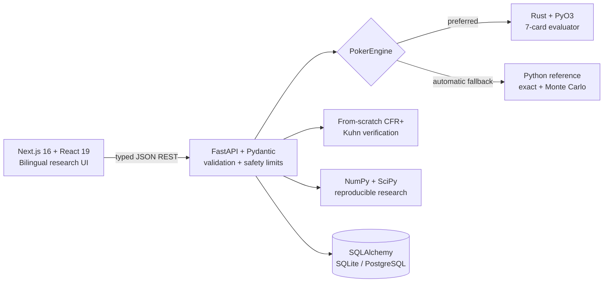

The API is the canonical result source. The frontend owns interaction and visualization, but never calculates canonical equity. Rust and Python evaluator outputs are cross-checked on seeded seven-card samples. See [architecture](docs/architecture.md), [mathematical notes](docs/math), and [solver limitations](docs/solver-limitations.md).

API 是结果真值源；前端负责交互与可视化，但不计算权威胜率。Rust 与 Python 评估器会在固定随机样本上交叉验证。详见[架构说明](docs/architecture.md)、[数学说明](docs/math)与[求解器边界](docs/solver-limitations.md)。

The Rust hot path uses fixed rank arrays and bitmasks while preserving complete best-of-21 enumeration. Its tests exhaustively cross-check all 2,598,960 five-card hands, including kickers; the Python reference and automatic fallback remain unchanged. / Rust 高频路径使用固定点数数组和位掩码，仍完整枚举 21 个五张子集；测试穷举核对全部 2,598,960 种五张牌及踢脚牌，Python 参考实现与自动回退保持不变。

Database schemas now upgrade automatically at API startup. Existing experiment, training-answer, and solver records are preserved; PostgreSQL stores every API-accepted seed (`0` through `2^63 - 1`) in a 64-bit column. If the configured database cannot be initialized, startup stops instead of silently sending new records to another database. Back up before upgrading; see [deployment and recovery](docs/deployment.md#database-upgrades-and-recovery--数据库升级与恢复).

数据库结构会在 API 启动时自动升级，保留现有实验、训练成绩与求解记录；PostgreSQL 使用 64 位字段存储 API 接受的全部种子（`0` 至 `2^63 - 1`）。指定数据库无法初始化时会停止启动，不再悄悄把新记录写入另一份数据库。升级前请备份，详见[部署与恢复](docs/deployment.md#database-upgrades-and-recovery--数据库升级与恢复)。

The experiment ledger now fetches 20 lightweight summaries per page and loads only the selected record's complete JSON. Copy/download preserves the server's original integer tokens, including seeds above JavaScript's safe-integer range. Newer runs do not shift the boundary while browsing older pages; refresh to see the latest records. The database badge comes from the live API, not a hardcoded SQLite label. See [history and export contracts](docs/experiment-history.md).

实验台账现在每页获取 20 条轻量摘要，仅按需加载选中记录的完整 JSON。复制和下载保留服务端原始整数文本，包括超出 JavaScript 安全整数范围的种子。浏览旧记录时，新实验不会挤动已发出的分页边界；刷新可查看最新记录。数据库标识来自实时 API，不再固定显示 SQLite。详见[历史与导出契约](docs/experiment-history.md)。

## Mathematical contract / 数学契约

Monte Carlo uncertainty remains nonzero even when every observed outcome agrees. New fixed-hand runs use finite-sample Hoeffding intervals with explicit method metadata; one-sample standard error is undefined, not zero. These are pointwise bounds at a fixed sample count, not a simultaneous band or an early-stopping rule. Saved historical results remain unchanged. See [the bilingual derivation and compatibility notes](docs/math/monte-carlo.md).

即使观察结果全相同，蒙特卡洛区间也不会压缩成“零误差”。新的固定手牌实验采用带明确方法元数据的有限样本 Hoeffding 区间；单样本标准误未定义，不显示为零。这是固定样本量下的逐点区间，不是同时置信带或提前停止规则；历史记录保持原样。详见[中英文推导与兼容性说明](docs/math/monte-carlo.md)。

- Equity / 胜率: `E = P(win) + 0.5 × P(tie)`
- Monte Carlo / 蒙特卡洛: `Êₙ = (1/n) ΣXᵢ`, where `Xᵢ ∈ {0, 0.5, 1}`
- Call EV / 跟注 EV: `EV(call) = e(P + B + C) − C`
- Bayesian update / 贝叶斯更新: `Beta(α, β) → Beta(α+s, β+f)`
- CFR+ regret matching / CFR+ 遗憾匹配: `σ(a) ∝ max(R(a), 0)`

Duplicate cards are rejected at the domain boundary. Monte Carlo samples legal runouts without replacement inside each trial. Range equity removes blocker collisions before normalization. / 重复牌会在领域边界被拒绝；蒙特卡洛在每次试验内进行无放回合法补牌采样；范围胜率会在归一化前移除阻断冲突。

## Validation / 验证

Seeds and run counts now require explicit JSON integers: booleans, numeric strings and floating-point values are rejected before calculation or storage. Valid seeded results, defaults and historical records remain unchanged. See the [bilingual experiment-control contract](docs/experiment-controls.md) for limits, 64-bit precision and client migration. / 种子与运行次数现在要求明确的 JSON 整数，布尔值、数字字符串和浮点数在计算或写入前即被拒绝；合法种子结果、默认值和历史记录保持不变。范围、64 位精度及客户端迁移详见[双语参数契约](docs/experiment-controls.md)。

Both editable browser seed controls preserve typed text and accept only digits representing integers from **0 to 9,007,199,254,740,991**. Equity Lab now shows inline English/Chinese errors before calculation, instead of silently rounding a large seed or treating an empty input as zero. Corrected inputs require a new run; late responses do not replace its results. The API still accepts exact signed 64-bit nonnegative seeds from suitable clients. / 浏览器的两个可编辑种子控件保留输入原文，仅接受数字组成的 **0 至 9,007,199,254,740,991** 整数。胜率实验室在计算前显示中英文就地错误，不再静默舍入大整数或将空输入当作零。修正后需重新计算，延迟响应不会替换新结果；API 仍接受适用客户端精确提交的非负有符号 64 位种子。

Run the complete local quality gate / 运行完整本地质量门禁:

```bash
make check
pnpm --filter web test:e2e
```

Browser tests now launch an isolated local stack: automatic loopback ports, a fresh SQLite database, a private frontend source/build snapshot, and per-run reports. They do not reuse services already running on 3000/8000 or inherit your database/API URL. The runner cleans up its temporary data after completion or handled interruption; existing development builds and your ledger remain separate. [Setup, debugging and limits](docs/browser-testing.md). / 浏览器测试现在启动独立本地环境：自动回环端口、全新 SQLite 数据库、私有前端源码/构建快照及独立报告。不复用 3000/8000 上已有服务，也不继承个人数据库/API 地址；完成或正常处理中断后清理临时数据，开发构建与个人台账保持独立。[安装、调试与边界](docs/browser-testing.md)。

The suite covers evaluator ordering, wheel straights, duplicate rejection, exact-equity symmetry, deterministic seeds, Monte Carlo statistical tolerance, weighted blockers, canonical range aliases, Rust/Python cross-checks, EV geometry, CFR strategy normalization, Kuhn convergence, structured API errors, component behavior, desktop workflows, and mobile overflow. Launcher regression tests cover concurrent credential initialization, private permissions, non-destructive error handling, and image reuse; API tests use isolated temporary databases.

测试覆盖牌力排序、A2345 顺子、重复牌拒绝、精确胜率对称性、固定种子、蒙特卡洛统计容差、加权阻断、范围别名、Rust/Python 交叉验证、EV 几何、CFR 策略归一化、Kuhn 收敛、结构化 API 错误、组件交互、桌面流程与移动端溢出。启动器回归测试覆盖并发凭据初始化、私有权限、无破坏性报错与镜像复用；API 测试使用隔离的临时数据库。

GitHub Actions runs formatting, linting, type checks, Python/Rust/frontend tests, production builds, desktop/mobile browser tests, and both container builds on every push and pull request.

Full-range regression tests verify every legal pair across preflop/flop/turn/river boards, original seeded pair/runout streams, and exact float accumulation order. / 全范围回归测试覆盖翻牌前、翻牌、转牌与河牌的每个合法组合对，并核对原始种子手牌/补牌序列及精确浮点累加顺序。

Bayesian charts preserve probability mass using API-computed CDF/survival differences over 200 bins, including narrow peaks and boundary tails. Numeric axes, step rendering, and bilingual notes distinguish density from probability and disclose the 0.5-percentage-point resolution. Credible intervals are computed independently; old records and point-sample export fields remain unchanged. [Method and compatibility notes](docs/math/bayesian.md). / 贝叶斯图改用 API 计算的 200 个区间概率，保留窄峰与边界尾部的概率质量；数值坐标、阶梯绘图和双语说明区分密度与概率，并公开每格 0.5 个百分点的分辨率。可信区间独立计算，旧记录与旧点采样导出字段保留。[方法与兼容性说明](docs/math/bayesian.md)。

Dependency audits are separate from the quality gate. Rechecked on **2026-10-30**: the development toolchain retains the October 24 pins of undici **8.12.2** and Zod **4.6.6**, alongside earlier framework patches. Full/production npm audits and the Python audit report no known advisories; Python skips the two local first-party packages. The previously reported `braces` advisory was **withdrawn upstream**, not patched or suppressed by PokerLab. These results do not prove vulnerability-free software. See [security status and exposure](SECURITY.md#known-dependency-advisories--已知依赖告警). / 依赖审计与质量门禁分开；**2026-10-30 复核**，保留 10 月 24 日锁定的开发工具链 undici **8.12.2**、Zod **4.6.6** 及此前框架补丁。完整/生产 npm 审计和 Python 审计均未报告已知告警，Python 跳过两个本地项目包。此前的 `braces` 告警由**上游撤回**，不是本项目修复或屏蔽。审计结果不代表软件绝无漏洞，详见[安全状态与影响边界](SECURITY.md#known-dependency-advisories--已知依赖告警)。

API failures use bilingual JSON and bounded request IDs; structured application logs omit raw exceptions, SQL parameters and private path values. The browser displays safe correlation IDs, rejects unreadable JSON instead of treating it as a successful empty result, and preserves HTTP error status, cancellation and lossless export text. Trainer recovery counts only readable successful responses. A failed response does not prove a write rolled back; see [error handling and recovery boundaries](docs/deployment.md#api-errors--api-错误). / API 错误使用中英文 JSON 与长度受限的请求编号，应用结构化日志不记录异常正文、SQL 参数和具体资源路径。浏览器显示安全编号，拒绝不可读 JSON，不再将其当作空结果成功处理；保留 HTTP 错误状态、取消语义和原文导出。训练恢复只有可读取的成功响应才计数；响应失败不证明写入回滚，详见[错误处理与恢复边界](docs/deployment.md#api-errors--api-错误)。

Showdown consumers accept only numeric **0 / 0.5 / 1**. Invalid evaluator output stops the calculation instead of silently becoming a loss or a misleading solver result; failed calculations do not create successful experiment/trainer records. Valid sampling and automatic startup engine fallback are preserved. See [the evaluator output contract](docs/math/equity.md#evaluator-output-contract--评估器输出契约). / 摊牌结果仅接受数字 **0 / 0.5 / 1**。非法评估器输出会中止计算，不再静默变成输牌或误导性的求解结果，失败计算不产生成功实验/训练记录；合法抽样与启动时引擎自动回退保留。详见[评估器输出契约](docs/math/equity.md#evaluator-output-contract--评估器输出契约)。

`pnpm test:dependencies` checks the actual launcher/image dependency copies: unsafe post-comment line terminators are rejected, ordinary quoted arguments and parallel commands still work, and native SVG/PNG/WebP processing returns verified pixels. It is part of `pnpm check`. CI also runs the image tests against the **final standalone container**, with no network and a read-only filesystem, checking both sharp and its loaded librsvg version. These targeted regressions do not replace a vulnerability audit. / `pnpm test:dependencies` 验证启动器与图像处理实际加载的依赖副本：拒绝注释后不安全的换行符、保留正常参数转义和并行启动，并核对原生 SVG/PNG/WebP 转换后的像素。该检查已纳入 `pnpm check`；CI 还在禁网、只读的**最终独立部署容器**中执行图像测试，同时检查 sharp 与实际加载的 librsvg 版本。这些定向回归测试不能代替漏洞审计。

The container gate also starts the **real standalone production server** and checks its Next.js version, all nine product routes, security headers, shipped JavaScript/CSS, 404 responses, remote-image rejection, and absence of the development MCP endpoint. It uses isolated container loopback without exposing host ports or touching a database. [Reproduce the deployment checks](docs/deployment.md#dependency-runtime-checks--依赖运行时检查). / 容器门禁还会启动**真实独立部署生产服务器**，检查 Next.js 版本、九个产品路由、安全响应头、打包 JavaScript/CSS、404、远程图片拒绝和开发 MCP 端点不可用；仅使用容器隔离回环网络，不开放宿主机端口或接触数据库。[复现部署验收](docs/deployment.md#dependency-runtime-checks--依赖运行时检查)。

Storage tests run against both SQLite and a disposable PostgreSQL service in CI, covering legacy migrations, 64-bit seeds, rollback, concurrent workers, and restart-safe training. / CI 同时在 SQLite 与临时 PostgreSQL 服务上验证存储行为，覆盖旧库迁移、64 位种子、回滚、并发进程及训练题跨重启提交。

The Python migration toolchain also pins Mako 1.4.2 for its Windows template-URI traversal fix. Tests cover POSIX/emulated Windows rejection and rendering the packaged Alembic template; no schema change is introduced. / Python 迁移工具链同时锁定 Mako 1.4.2，修复 Windows 模板 URI 遍历问题；测试覆盖 POSIX/模拟 Windows 的拒绝行为与实际 Alembic 模板渲染，不引入数据库结构变更。

Research regressions check policy thresholds, historical seeded values, an independent uncertainty calculation, saved methodology, exact browser seed validation, and metadata-rich CSV escaping. / 研究回归测试覆盖策略阈值、历史固定种子结果、独立误差公式复核、方法持久化、浏览器种子精度校验与携带完整参数的 CSV 转义。

Fixed-hand Monte Carlo regressions enumerate multinomial outcome counts to check finite-sample coverage without random pass/fail thresholds. They also cover one-sample null moments, identical observations, historical seeded values on both engines, stored method metadata, bilingual explanations, and exact chart endpoints. / 固定手牌蒙特卡洛回归通过枚举多项分布结果次数验证有限样本覆盖率，不使用随机通过阈值；同时覆盖单样本空统计量、相同观察值、双引擎历史种子结果、方法元数据持久化、双语说明及图表端点。

Fixed-hand postflop simulations now reuse previously evaluated runouts within each request (at most 990/44/1 cache entries on flop/turn/river; no preflop cache). Every random draw and sample contribution is preserved. Tests compare complete non-runtime results and draw sequences with the original loop, including reversed runouts, losses, real split pots, concurrent requests, and SQLite/PostgreSQL exports. [Why this preserves the estimate](docs/math/monte-carlo.md#request-local-showdown-reuse--单次请求内的摊牌复用). / 固定手牌的翻牌后模拟在单次请求内复用已评估补牌，缓存上限分别为翻牌 990 项、转牌 44 项、河牌 1 项，翻牌前不缓存；每次随机抽牌和样本贡献保持不变。测试完整核对原循环的非耗时结果与抽牌序列，覆盖反序补牌、输牌、真实平局、并发请求及 SQLite/PostgreSQL 导出。

Turn-map regressions compare every legal turn with independent exact enumeration, verify split pots and player-swap symmetry, and cross-check Rust against Python. Both engines reject duplicate cards across players at the showdown boundary. / 转牌地图回归测试逐张对照独立精确枚举，验证平局、双方交换对称性及 Rust/Python 一致性；两个引擎均在摊牌入口拒绝双方持有重复牌的非法状态。

Solver regressions compare full cached/uncached strategies and convergence traces on both engines. Real SQLite/PostgreSQL constraint failures verify rollback, original-error preservation, job status, and concurrency-slot release. / 求解回归测试在双引擎下对照缓存与未缓存的完整策略和收敛轨迹；通过真实 SQLite/PostgreSQL 约束错误验证回滚、原始异常保留、任务状态及并发名额释放。

The solver page and diagnostics share a real **20,000-iteration Kuhn self-test computed once per API worker startup**. Repeated and concurrent reads do not retrain CFR; restarts recompute it. Tests compare the complete result, including every strategy, and ensure failed checks remain visible. This is a startup fixture, not live river-solver validation or a full-game GTO guarantee. [Details](docs/math/cfr.md#kuhn-fixture--kuhn-验证). / 求解器页面和诊断接口共享 **API 每个工作进程启动时真实计算一次的 20,000 轮 Kuhn 自检**；重复及并发读取不再重跑 CFR，重启后重新计算。测试核对包括所有策略在内的完整结果，并确保失败状态不会被掩盖。这是启动验证样例，不是实时河牌求解验证或完整牌局 GTO 保证。[详情](docs/math/cfr.md#kuhn-fixture--kuhn-验证)。

CFR allocation regressions additionally compare every information set's action order, cumulative regrets, strategy sums and average strategy with frozen eager-allocation traversals. Continued training, concurrent job isolation and durable API results are covered. / CFR 分配回归进一步对照冻结的原遍历算法，逐个信息集核对动作顺序、累计遗憾、策略累加与平均策略，并覆盖连续训练、并发任务隔离及 API 结果持久化。

## Measured benchmark / 实测基准

On **2026-10-29**, the Python reference evaluator removed redundant uniqueness checks inside its 21-subset seven-card evaluation. Five-run median time fell **267.938 → 225.359 ms (15.9%)** for 5,000 seven-card hands and **106.893 → 95.071 ms (11.1%)** for an exact-flop calculation. Standalone five-card timing was effectively unchanged. Public duplicate-card validation, complete rank vectors, seeded outputs and Rust fallback remain intact. Tests exhaustively compare all **2,598,960 five-card hands** with the original implementation. These are Python core measurements, not Rust or whole-app speedups. [Method, limits and raw data](research/benchmarks.md#python-validation-reuse--python-校验复用--2026-10-29).

**2026-10-29**，Python 参考评估器移除七张牌 21 个子集中的重复唯一性检查。五次中位耗时：5,000 组七张牌由 **267.938 降至 225.359 毫秒（15.9%）**，翻牌精确胜率由 **106.893 降至 95.071 毫秒（11.1%）**，独立五张牌基本持平。保留公开入口重牌校验、完整牌力向量、固定种子输出和 Rust 回退；测试穷举全部 **2,598,960 种五张牌**与原算法对照。这是 Python 核心实测，不代表 Rust 或整个应用的提速，方法、限制和原始数据见上述链接。

Reproduce / 复现：`cd apps/api && uv run python -m pokerlab_api.python_evaluator_benchmark`

On **2026-10-27**, river information-set lookup reuse reduced private-key formatting from **183,000 to 54** in a 61-deal, 500-iteration job. Five-run median time fell **461.98 → 418.17 ms with Python evaluation** and **453.57 → 396.58 ms with Rust evaluation**. Every node's accumulated state and complete output match the pre-change traversal exactly. This adds one lookup entry per information set; it does not reduce memory or improve the solving algorithm. [Method, controls and raw evidence](research/benchmarks.md#river-node-lookup--河牌节点查找--2026-10-27).

**2026-10-27**，河牌信息集查找复用使 61 个手牌对、500 轮求解的私牌键格式化从 **183,000 次降至 54 次**；五次中位耗时由 **461.98 降至 418.17 毫秒（Python 评估）**、**453.57 降至 396.58 毫秒（Rust 评估）**。全部节点累计状态与完整结果精确一致。每个信息集额外增加一个查找条目，不代表节省内存或改进求解算法，方法、对照与原始数据见上述链接。

Reproduce / 复现：`cd apps/api && uv run python -m pokerlab_api.cfr_lookup_benchmark`

These are reproducible observations from `pnpm benchmark`, not universal performance claims. Recorded on macOS ARM with Python 3.12 using the Python reference path:

| Workload / 工作负载                             |    Observed / 实测 |
| ----------------------------------------------- | -----------------: |
| Seven-card evaluation / 七张牌评估              |      22,317 eval/s |
| Exact flop scenario, 990 runouts / 翻牌精确场景 |  10.95 scenarios/s |
| Monte Carlo / 蒙特卡洛                          |   10,561 samples/s |
| One-class river range equity / 单类河牌范围胜率 | 145.97 scenarios/s |
| CFR one-class iteration / 单类 CFR 迭代         | 34.10 iterations/s |

Methodology and caveats / 方法与限制: [research/benchmarks.md](research/benchmarks.md)

On 2026-10-16, lazy CFR node creation reduced information-set constructions from **183,000 to 54** in a 61-deal, 500-iteration river job. Five-repeat medians improved from **496.74 to 466.08 ms (Python evaluator)** and **496.30 to 467.13 ms (Rust evaluator)**; CFR traversal itself remains Python. The 5,000-iteration Kuhn fixture improved from **127.75 to 103.36 ms**. Complete results and every node's accumulated state match the original traversal exactly. These are modest workload-specific timing gains, not reduced retained memory or stronger solving guarantees. [Method and raw evidence](research/benchmarks.md#cfr-information-set-allocation--cfr-信息集分配--2026-10-16).

2026-10-16，CFR 节点按需创建使 61 组手牌对、500 轮河牌求解的信息集构造次数从 **183,000 降至 54**。同机五次耗时中位数由 **496.74 降至 466.08 毫秒（Python 评估器）**、**496.30 降至 467.13 毫秒（Rust 评估器）**；CFR 遍历本身仍为 Python。5,000 轮 Kuhn 验证由 **127.75 降至 103.36 毫秒**。完整输出和全部节点累计状态与原遍历精确一致。这是特定场景下的适度提速，不代表常驻内存减少或求解保证增强。

Reproduce / 复现：`cd apps/api && uv run python -m pokerlab_api.cfr_allocation_benchmark`

On 2026-10-14, a same-machine, three-repeat comparison of 10,000 fixed-hand flop samples measured **973.23 → 104.76 ms on Python (9.29×)** and **49.07 → 12.89 ms on Rust (3.81×)** by reusing repeated runout evaluations. Every draw and complete non-runtime result matched the original loop. Caches are request-local and bounded; preflop remains uncached. These are workload-specific core timings, not HTTP or whole-app speedups. [Full methodology, control workloads and raw measurements](research/benchmarks.md#fixed-hand-monte-carlo-showdown-reuse--固定手牌蒙特卡洛摊牌复用--2026-10-14).

2026-10-14 同机三次对照中，10,000 次固定手牌翻牌模拟通过复用重复补牌评估，耗时中位数由 **Python 973.23 → 104.76 毫秒（9.29×）**、**Rust 49.07 → 12.89 毫秒（3.81×）**；每次抽牌及全部非耗时结果与原循环一致。缓存仅限单次请求且有固定上限，翻牌前不缓存。这些是指定核心工作负载的计时，不代表 HTTP 或整站加速。

Reproduce / 复现：`cd apps/api && uv run python -m pokerlab_api.monte_carlo_benchmark`

Weighted range sampling now builds its cumulative probability table once per request. In a separate 20-class, 5,000-sample benchmark on the same machine, median end-to-end time fell from 1,217 to 505 ms on Python and from 822 to 120 ms with Rust. The seeded result is unchanged. These are workload-specific measurements, not a promise for every calculation.

加权范围采样现在每次请求只构建一次累计概率表。在同机独立测试的 20 类手牌、5,000 次采样场景中，Python 路径耗时中位数从 1,217 降至 505 毫秒，Rust 路径从 822 降至 120 毫秒，固定种子结果不变。这是特定工作负载的实测，不代表所有计算都具有同样增益。

Reproduce / 复现：`cd apps/api && uv run python -m pokerlab_api.benchmarks --range-only`

Full-range pair preparation now uses compact arrays while preserving every legal pair and seeded result. On the measured machine, all 169 classes per player (1,624,350 preflop pairs) used **199.31 → 31.69 MiB** peak traced Python allocations (**84.1% less**) and **809.86 → 158.66 ms** median setup time. This includes pair construction, mass summation, and cumulative weights—not equity evaluation, process RSS, HTTP, or the UI. Memory remains O(pairs). See [methodology and raw timings](research/benchmarks.md#compact-range-pair-preparation--紧凑范围组合对准备--2026-10-06).

全范围组合对准备现使用紧凑数组，保留每个合法组合与种子结果。同机实测每人全部 169 类手牌（翻牌前 1,624,350 对），Python 跟踪分配峰值从 **199.31 降至 31.69 MiB（减少 84.1%）**，准备耗时中位数从 **809.86 降至 158.66 毫秒**。测量包含组合对构建、权重求和及累计表，不包含胜率评估、进程 RSS、HTTP 或界面；内存仍为 O(组合对数)。方法和原始耗时见上述链接。

Reproduce / 复现：`cd apps/api && uv run python -m pokerlab_api.range_pair_benchmark`

The exact turn map now shares unordered runouts: 990 showdown evaluations instead of 1,980, with all 45 conditional equities unchanged. A five-repeat local algorithm comparison measured median times of **204 → 104 ms (Python)** and **41 → 20 ms (Rust)**. Both compared algorithms use the same current evaluator and validation; these are turn-map measurements, not whole-app speedups. See the [derivation / 数学推导](docs/math/equity.md#conditional-turn-map--条件转牌地图) and [benchmark record / 实测记录](research/benchmarks.md).

精确转牌地图现在复用无序补牌组合，将摊牌评估从 1,980 次减少到 990 次，全部 45 张转牌的条件胜率保持不变。同机五次算法对照实测耗时中位数为 **Python 204 → 104 毫秒、Rust 41 → 20 毫秒**。两种算法使用相同的当前评估器和校验逻辑；该结果仅代表转牌地图，不是整个应用的加速比。

Reproduce / 复现：`cd apps/api && uv run python -m pokerlab_api.benchmarks --turn-map-only`

River CFR now reuses each fixed deal's actual showdown outcome within its job. In a 61-deal, 100-iteration local benchmark, evaluations fell from **30,500 to 61**, with unchanged strategies and convergence. Median time was **3,270 → 113 ms on Python (29.01×)** and **743 → 103 ms on Rust (7.19×)**. These ratios describe this workload only; the finite game tree and [solver limitations](docs/solver-limitations.md) are unchanged.

河牌 CFR 现在在任务内复用每组固定牌面的真实摊牌结果。在 61 组手牌对、100 轮的本地基准中，评估次数由 **30,500 减至 61**，策略与收敛轨迹不变。耗时中位数为 **Python 3,270 → 113 毫秒（29.01×）、Rust 743 → 103 毫秒（7.19×）**。这些比率仅适用于该工作负载，有限博弈树和[求解器限制](docs/solver-limitations.md)保持不变。

### Rust evaluator throughput / Rust 评估器吞吐

In the 2026-10-03 same-machine, five-repeat comparison against `b3adcda`, 5,000 varied seven-card evaluations fell from **42.64 to 9.79 ms (4.35×)** and 10,000 Monte Carlo samples from **189.31 to 50.47 ms (3.75×)**. Both extensions used the same release compiler. All complete non-runtime results match the independent Python reference, including confidence intervals and convergence checkpoints. These are core workload measurements, not whole-app latency promises; [full timings and reproduction](research/benchmarks.md#rust-evaluator-hot-path--rust-评估器高频路径--2026-10-03).

2026-10-03 同机五次对照 `b3adcda` 的实测中，5,000 组不同七张牌评估从 **42.64 降至 9.79 毫秒（4.35×）**，10,000 次蒙特卡洛从 **189.31 降至 50.47 毫秒（3.75×）**；两份扩展使用相同 release 编译器。全部非耗时结果与独立 Python 参考实现一致，包括置信区间与收敛检查点。这些是核心工作负载实测，不是整个应用延迟承诺；完整耗时与复现方式见上述链接。

Reproduce / 复现：`cd apps/api && uv run python -m pokerlab_api.benchmarks --solver-only`

## Repository map / 仓库结构

```text
apps/web/                 Next.js product UI and browser tests
apps/api/                 FastAPI, reference engine, CFR, research, persistence
packages/poker-core/      Rust evaluator and PyO3 extension
docs/math/                Inspectable mathematical definitions
research/                 Measured benchmark record
infra/                    Reproducible container builds
.github/workflows/        Continuous quality gates
```

## Scope and responsible use / 范围与负责任使用

The solver is heads-up, river-only, fixed-board, fixed-range, and no-raise. Its displayed regret is a convergence diagnostic—not rigorous exploitability. PokerLab does not implement payments, deposits, casino integration, screen capture, real-time play advice, or automated betting.

求解器仅覆盖单挑、河牌、固定公共牌、固定范围与无加注树；显示的遗憾值是收敛诊断，不是严格 exploitability。本项目不实现支付、存款、赌场接入、屏幕抓取、实时牌局建议或自动下注。

## Contributing and security / 贡献与安全

Read [CONTRIBUTING.md](CONTRIBUTING.md) before proposing mathematical or behavioral changes. Report vulnerabilities according to [SECURITY.md](SECURITY.md). Released under the [MIT License](LICENSE).

提交数学或行为变更前请阅读 [CONTRIBUTING.md](CONTRIBUTING.md)；安全问题请按 [SECURITY.md](SECURITY.md) 报告。本项目使用 [MIT License](LICENSE)。
