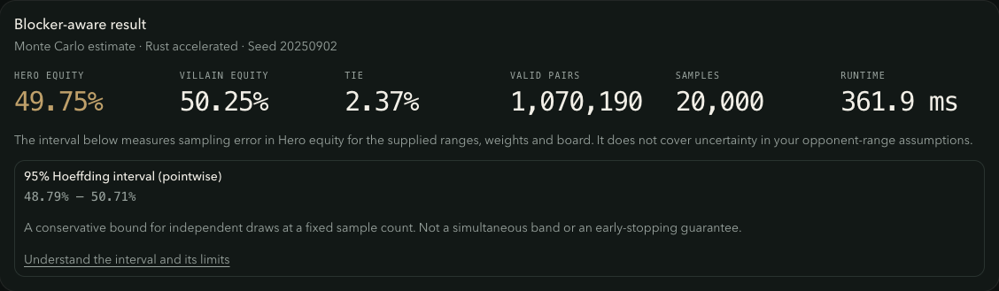

# Range editing / 范围编辑

The Range Lab matrix edits starting-hand weights; physical combinations, blockers
and equity are calculated by the poker backend. The active hand's slider supports
1% precision. Hero and villain ranges remain independent.

范围实验室矩阵用于编辑起手牌权重；物理组合、阻断牌和胜率由扑克后端计算。
当前手牌的滑块支持 1% 精度，英雄与对手范围分别保存。

On narrow screens only the card grid scrolls horizontally, keeping the editing
instructions and precision slider in view. / 窄屏仅横向滚动牌格区域，操作提示与精度
滑块保持可见。

| Input / 输入 | Behavior / 行为 |
| --- | --- |
| Click, tap, Enter or Space / 点击、轻触、Enter 或空格 | Advance to the next 25% step, wrapping from 100% to 0%. A custom 37% becomes 50%. / 前进至下一个 25% 档位，100% 后回到 0%；自定义 37% 下一步为 50%。 |
| Mouse drag / 鼠标拖动 | Hold the primary button and paint the first cell's new weight over each entered cell. / 按住主按钮，将起始单元格的新权重涂到经过的单元格。 |
| Touch or pen swipe / 触屏或触控笔滑动 | Scroll normally; only a completed tap edits a cell. Drag painting is mouse-only. / 正常滚动，仅完成轻触才修改单元格；拖动涂选仅限鼠标。 |
| Arrow keys / 方向键 | Move focus without changing weights; stop at matrix edges. / 移动焦点，不修改权重，到达矩阵边界后停止。 |
| Home / End | First / last cell in the current row. / 当前行首 / 行末。 |
| Ctrl + Home / End | First / last cell of the matrix. / 整张矩阵首 / 尾单元格。 |
| Tab / Shift + Tab | Enter or leave the matrix through one tab stop. Shift + Tab from the selected cell reaches its precision slider. / 通过一个 Tab 停靠点进入或离开矩阵；从选中单元格按 Shift + Tab 可到达精度滑块。 |
| Slider arrow keys / 滑块方向键 | Adjust the selected hand by 1%. / 每次调整当前手牌权重 1%。 |

Right-click, middle-click and Ctrl-click do not edit. Painting stops on release,
pointer cancellation, window blur, a hidden tab or a context menu. If release
occurs outside the window, re-entering without the primary button held also stops
the stroke. Existing edits remain; stopping a stroke is not undo.

右键、中键及 Ctrl + 点击不会修改权重。松开按钮、指针取消、窗口失焦、标签页隐藏
或打开上下文菜单时停止涂选；若在窗口外松开，未按住主按钮重新进入也会停止。
此前已完成的修改保留，停止涂选不等于撤销。

The grid has 13 rows and 169 cells, with a single focusable button in the page's
tab order. Cell names expose the current weight; instructions and accessible
labels follow the English/Chinese language setting. This follows the
[WAI-ARIA grid keyboard pattern](https://www.w3.org/WAI/ARIA/apg/patterns/grid/).

网格含 13 行、169 个单元格，页面 Tab 顺序中只包含其中一个按钮。单元格名称包含
当前权重，提示与无障碍名称跟随中英文语言设置；键盘操作遵循上述 WAI-ARIA 网格模式。

## Reading equity results / 解读权益结果

The editor calculates a five-card river board. The backend enumerates up to
250,000 legal states; larger ranges use Monte Carlo even on the river. The result
names the method and selected engine. Sampled runs show the actual sample count,
seed and a conservative 95% Hoeffding interval for **Hero equity**. The editor
requests 20,000 samples with seed `20250902`; the API accepts other valid settings.
Exact results explicitly state that all legal states were enumerated.

编辑器计算五张公共牌的河牌结果。后端枚举最多 250,000 个合法状态；更大的范围即使
在河牌也使用蒙特卡洛。结果标明计算方法与实际引擎；抽样结果显示实际样本数、种子
及**英雄权益**的保守 95% Hoeffding 区间。编辑器请求 20,000 个样本、种子
`20250902`；API 支持其他合法设置。精确结果明确说明已枚举全部合法状态。

The interval describes sampling error for the supplied ranges, weights and board,
not uncertainty about the opponent's true range. It assumes a fixed sample count
and is not an early-stopping rule. Editing either range or the board hides the old
result and its interval together. Older APIs without method metadata display an
unconfirmed-method explanation, never a fabricated interval. [Derivation and API
contract](math/equity.md#exact-and-sampled-results--精确与抽样结果).

区间描述给定范围、权重及公共牌下的抽样误差，不代表对手真实范围的不确定性；
适用于预先固定的样本量，不是提前停止规则。修改任一范围或公共牌会同时隐藏旧结果
与旧区间。旧版 API 缺少方法元数据时显示方法未确认说明，不编造区间。推导及接口
契约见上述链接。

### Verified sampled result / 抽样结果实测

On November 9, 2026, the Docker deployment produced the result below with the
Rust evaluator. Reproduce in Range Lab: for **each player**, select the tab, then
**Clear → Invert** to include all 169 classes at weight 1. Keep the default board
`Ah 7d 5s 3c 2h` and calculate. At 20,000 samples and seed `20250902`, Hero equity
is **49.75%**, with a **48.79%–50.71%** interval. Runtime depends on machine/load.
The desktop English and mobile Chinese flows verified these bounds against the
real API and saved JSON, and checked that editing removes the stale interval.

2026 年 11 月 9 日，Docker 部署使用 Rust 评估器得到下图真实结果。复现步骤：
分别选择**双方**范围标签，执行**清空 → 反选**，将全部 169 个类别设为权重 1；
保留默认公共牌 `Ah 7d 5s 3c 2h` 并计算。20,000 个样本、种子 `20250902` 下，
英雄权益为 **49.75%**，区间为 **48.79%–50.71%**；耗时取决于机器及负载。
桌面英文和移动端中文流程均核对了真实 API 与保存 JSON 的端点，并验证编辑后
旧区间立即隐藏。



[Chinese mobile result / 中文移动端结果](../output/playwright/range-uncertainty-mobile-zh.png)

## Statistics and recovery / 统计与恢复

The first statistics read starts immediately. New range, active-player or board
inputs wait for a 150 ms editing pause before fetching; matching recent cached
inputs can be reused. Changing inputs cancels the obsolete browser request
immediately, and late responses cannot replace the current statistics. During
editing or fetching, a status message takes the place of the numbers.

首次统计立即读取；范围、当前玩家或公共牌变化后，等待编辑暂停 150 毫秒再请求，
近期相同输入的缓存可以复用。输入改变时立即取消过时浏览器请求，迟到响应不会替换
当前统计。编辑或读取期间使用状态提示代替数值。

A failed read shows a bilingual explanation, the API request ID when available,
and **Retry statistics**. There is no automatic retry loop for statistics failures.
Retry uses the current range and blockers without clearing them. Offline requests
show a reconnect message and resume when the browser reports it is online again.
An empty range is valid for statistics and displays the backend's zeros.

读取失败时显示双语说明、API 提供的请求编号和**重试统计**按钮，不循环自动重试。
重试使用当前范围与阻断牌，不清空编辑内容。离线请求显示恢复连接提示，在浏览器
报告重新联网后继续读取。空范围可以查询统计，并显示后端返回的零值。

Cancellation stops the browser's work; it does not guarantee that an already
received server calculation stops. `/range/statistics` is read-only and creates
no experiment. Explicit range-equity calculations retain their existing inputs,
seed, storage and retry behavior; the new cancellation signal is only used for
statistics reads. The shared three-minute transport timeout is preserved.

取消请求会停止浏览器侧工作，但不保证服务端已接收的计算也停止。`/range/statistics`
只读且不创建实验。显式范围胜率计算保留原有参数、种子、存储与重试行为，新增取消
信号仅用于统计读取；共用传输层的三分钟超时保持有效。

## Verification / 验证

```bash
pnpm --filter web test src/components/range-matrix.test.tsx
pnpm --filter web test src/app/range/page.test.tsx src/lib/api.test.ts
pnpm --filter web test:e2e
```

Component regressions cover quarter steps, native keyboard activation, focus
boundaries, slider precision, rapid strokes, pointer identity, interruption,
disabled state, controlled range replacement and Chinese labels. The existing
browser suite exercises Range Lab with the real API. For manual touch acceptance,
swipe across the matrix on a narrow touch viewport: horizontal scroll must move
while every weight stays unchanged; a subsequent tap must advance just one cell.
See [browser verification](browser-testing.md) for isolated services and reports.

组件回归覆盖档位、原生键盘激活、焦点边界、滑块精度、快速涂选、指针身份、中断、
禁用状态、受控范围替换和中文名称；现有浏览器套件使用真实 API 验证范围实验室。
手动触屏验收时，在窄触屏视口横向滑动矩阵：滚动位置应改变，全部权重应保持不变；
随后轻触应只推进一个单元格。隔离服务和报告说明见[浏览器验收](browser-testing.md)。

On November 6, 2026, desktop Chrome and Chrome with an iPhone 15 touch viewport
passed the manual flow against the Docker stack and real API. A native touch
swipe scrolled 291 CSS pixels without changing any weight; the slider stayed in
place and the next tap changed only one hand. This is browser touch emulation,
not physical-device or screen-reader certification.

2026 年 11 月 6 日，桌面 Chrome 与模拟 iPhone 15 触屏视口的 Chrome 使用 Docker
部署和真实 API 通过上述验收：原生触控事件横向滚动 291 CSS 像素，全部权重保持
不变，滑块位置不变，随后轻触仅修改一个手牌。这是浏览器触屏模拟，不代表实体设备
或屏幕阅读器认证。[中文移动端截图](../output/playwright/range-input-mobile-zh.png)。

Statistics regressions exercise the real query client and JSON transport with
test-only responses: initial loading, English/Chinese failures and retry,
150 ms request coalescing, cancellation and late responses, hero/villain/blocker
isolation, offline reconnect, empty ranges, unmount cleanup and React Strict Mode.
Transport tests retain both caller cancellation reasons and request timeouts.

统计回归使用真实查询客户端及 JSON 传输层，响应仅为测试夹具：覆盖首次读取、
中英文失败与重试、150 毫秒请求合并、取消与迟到响应、英雄／对手／阻断牌隔离、
断网重连、空范围、卸载清理及 React Strict Mode。传输测试同时验证调用方取消原因
与请求超时均得到保留。

On November 8, 2026, desktop Chrome against the Docker deployment sent **one
statistics request for a continuous ten-cell mouse stroke**. Its displayed
weighted-combo count matched the real API response. Desktop English and mobile
Chinese flows recovered from an intentionally blocked statistics request via one
explicit retry; the mobile flow also resumed after offline/reconnect. Ranges and
board cards were preserved. This is a specific interaction check, not a general
latency or server-computation benchmark.

2026 年 11 月 8 日，桌面 Chrome 连接 Docker 部署实测：**连续涂选十个牌格仅产生
一次统计请求**，显示的加权组合数与真实 API 响应一致。桌面英文及移动端中文流程
在主动阻断统计请求后，通过一次手动重试恢复，范围与公共牌保持不变；移动端还验证
了离线后的自动恢复。此为特定交互验证，不代表通用延迟或服务端计算性能基准。

Error-state screenshots use an intentionally blocked network request, not a
simulated successful calculation: [English desktop](../output/playwright/range-statistics-error-en.png)
and [Chinese mobile](../output/playwright/range-statistics-error-zh.png).
错误状态截图来自主动阻断的网络请求，不包含模拟成功计算结果。
